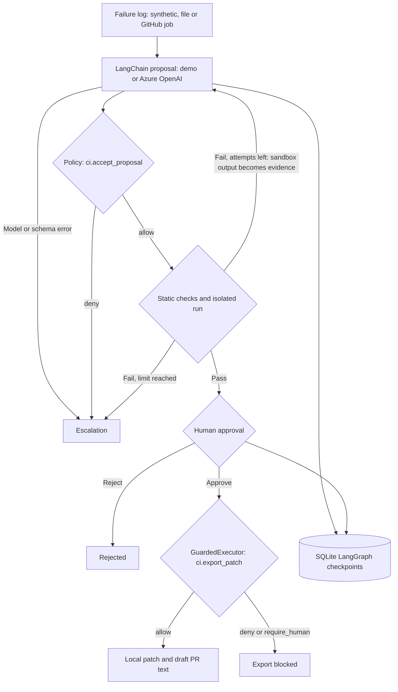

# LangGraph CI Repair Agent

A bounded CI repair workflow: diagnose a failure, propose one file change, authorize it
with a versioned policy, validate it statically and in an isolated run, and request
human approval before exporting a patch and draft PR text.

> The model proposes; deterministic policy authorizes; execution is verified.

**Status:** finished proof of concept (v1.0). Uses real LangGraph orchestration and
LangChain interfaces. Demo responses are scripted; Azure mode calls a real model. No
mode creates a GitHub PR or pushes anything.

## What has and has not been shown

| Claim | Evidence |
|---|---|
| S01–S05 are repaired and S06 (a failing assertion) is escalated, with the scripted model | [`evidence/demo-results.json`](evidence/demo-results.json), regenerated and checked in CI |
| The pipeline works on real GitHub Actions logs: each fixture runs as a real CI job, the agent reads the downloaded job log, isolated runs reveal the next failure, and the export passes the policy | [`evidence/real-actions-logs-2026-11-17.md`](evidence/real-actions-logs-2026-11-17.md); re-run by the `Real CI logs` workflow on every PR |
| Candidates run in a container with no network, a read-only root, no capabilities and a non-root user | `Real CI logs` workflow, job `scenarios in a network-less container` (S01–S05 repaired, S06 escalated on 2026-11-17) |
| A real model on Azure OpenAI (`gpt-4.1-mini`): S01 repaired, with the proposal and the export authorized by the v1.0 policy after human approval | [S01, 2026-11-17](evidence/live-azure-s01-2026-11-17.md). Earlier, before the policy library and isolation: [S01](evidence/live-azure-s01-2026-11-09.md) exported and [S05](evidence/live-azure-s05-2026-11-09.md) escalated after a policy rejection |

Not shown: diagnosis quality of a real model (there is no evaluation set), runs on
arbitrary repositories, and publishing a GitHub PR. The scripted model makes the
pipeline testable; it is not evidence of AI quality.

## Individual lab reports

Use `python scripts/validate_lab.py smoke` for this repository's existing lab.
For setup, smoke, verified deletion, recreation and another smoke/delete,
use the explicit `cycle` command in the [lab validation guide](docs/lab-validation.md).
Each run writes its own JSON/Markdown report under `.local/reports/`.
Verdicts and exit codes: PASS (0), FAIL (1), INCONCLUSIVE (2).
No combined report across repositories is produced.

## Scope

| Scenario | Failure | Permitted correction |
|---|---|---|
| S01 | Missing requirements file | `requirement.txt` → `requirements.txt` |
| S02 | Missing Python dependency | Append `requests` to `requirements.txt` |
| S03 | Misspelled test module | `pytests` → `pytest` |
| S04 | S01 and S02 together | Two attempts, one file each; the second sees the first |
| S05 | S01, S02 and S03 together | Up to three proposals, one file each |
| S06 | Failing assertion in a test | None: tests are protected, so the agent escalates |

A fix is authorized only if the failure evidence matches its rule, so a correct-looking change for a different failure is rejected.

Inputs are synthetic repository snapshots. They are real enough to run: the `Real CI logs` workflow executes each one on a GitHub-hosted runner, and the isolated runner executes candidates the same way. The original snapshot is never changed.

## Architecture



LangGraph handles conditional routing, a maximum of two proposal attempts (three for S05), SQLite checkpoint persistence and `interrupt`/`Command` approval. An accepted but insufficient change is kept in `working`, and the next attempt builds on it with the earlier attempts and reasons in `history`. LangChain provides message interfaces, a demo Runnable and `AzureChatOpenAI.with_structured_output` with a Pydantic schema. A policy rejection escalates immediately.

## Policy as code

Authorization uses [agent-policy-guard](https://github.com/JeanneBM/agent-policy-guard), pinned to a reviewed commit. The rules live in [`ci_repair/policies/ci_repair.yaml`](ci_repair/policies/ci_repair.yaml), not in Python branches.

- **`ci.accept_proposal`** decides whether a proposal may enter validation. The host computes the facts from the snapshot and the repair rules: path in the snapshot, file actually changed, test file touched, change reachable by a rule that the failure evidence triggers. Default deny.
- **`ci.export_patch`** runs only through a `GuardedExecutor`. Its facts are recomputed at export time: human approval, static validation of the final files, every step allowed, no test file changed, and the isolated result. That result counts only if its snapshot hash matches the files being exported. A run without isolation can only export under the separate `static-demo` rule.
- Each decision writes a metadata-only event to `artifacts/<thread>/policy-audit.jsonl`: policy ID, version and hash, request hash, decision and matched rules. It contains no file content, logs or prompts.

The model never supplies a fact. Prompt-injected text in a log can at most trigger one of the three fixed, allow-listed repairs.

## Isolated validation

`--isolation venv` or `--isolation docker` runs the candidate's own CI commands before approval. The host first turns the workflow into a plan of recognised command shapes:

- `python -m pip install -r <file>`, with allow-listed requirement names only;
- `python -m pytest ...`, without plugin or config overrides;
- `python -m <name>`, only when no such module exists in the sandbox, so it can only fail.

Anything else is refused before execution and blocks the export.

| Backend | Isolation |
|---|---|
| `venv` | Temporary copy, fresh virtual environment, environment variables reduced to a minimal set (no tokens or cloud credentials), timeout. Process isolation only. |
| `docker` | Throwaway container with `--network none`, read-only root, `--cap-drop ALL`, `no-new-privileges`, user 65534 and CPU, memory and PID limits. Packages come only from a read-only wheelhouse. |

The sandbox output is real pip and Python output. When a candidate fails, that output becomes evidence for the next attempt. Real CI stops at the first failing step, so this is how the later defects of S04 and S05 become visible.

```bash
python -m pip download --only-binary=:all: -d .local/wheelhouse -r isolation/wheelhouse.txt
python -m ci_repair.cli run --scenario S05 --thread s05-isolated --isolation venv --wheelhouse .local/wheelhouse
```

Without `--wheelhouse`, the venv backend installs from the package index and passes on only proxy and CA settings. The docker backend requires a wheelhouse built for the image's Python version (see `.github/workflows/real-logs.yml`). Tested on Linux in CI.

## Real GitHub Actions logs

`--log-file PATH` reads a downloaded job log. `--github-job OWNER/REPO:JOB_ID` downloads one through the REST API with `GITHUB_TOKEN` or `GH_TOKEN`; the token needs read access to Actions. The adapter (`ci_repair/actions_logs.py`) is read-only. It does not forward the token to the signed download URL. It strips timestamps, colours and group markers, and redacts token-, key- and password-like strings. Long logs keep the lines above each failed step first. The cleaned log, its source and the SHA-256 of the raw log are stored in the thread's evidence.

```bash
python -m ci_repair.cli run --scenario S05 --thread s05-real --log-file job.log --isolation venv --wheelhouse .local/wheelhouse
```

The scenario still provides the repository snapshot; the log replaces its synthetic failure text.

## Quick start

Python 3.11 or newer. Run commands from the project directory:

```bash
python -m venv .venv
# Linux/macOS:
source .venv/bin/activate
# PowerShell instead:
# .venv\Scripts\Activate.ps1
python -m pip install -e '.[dev]'
python -m ci_repair.cli run --scenario S01 --thread s01-demo
python -m ci_repair.cli status --thread s01-demo
```

Read `artifacts/s01-demo/evidence.json`, including the proposed diff and validation result. Then explicitly approve or reject:

```bash
python -m ci_repair.cli approve --thread s01-demo
# OR:
python -m ci_repair.cli reject --thread s01-demo
```

Approval exports `repair.patch` and `draft-pr.md` in that thread's directory, but only if the export policy allows it. Use a different thread ID for every new run. The SQLite checkpoint permits approval from a new process. Keep the same `--output` directory when resuming.

Run the other scenarios:

```bash
python -m ci_repair.cli run --scenario S02 --thread s02-demo
python -m ci_repair.cli run --scenario S03 --thread s03-demo
python -m ci_repair.cli run --scenario S04 --thread s04-demo   # needs two attempts
python -m ci_repair.cli run --scenario S05 --thread s05-demo
python -m ci_repair.cli run --scenario S06 --thread s06-demo   # escalates: tests are protected
python -m pytest -q
```

The isolated-run tests are skipped unless `CI_REPAIR_WHEELHOUSE` points to a wheelhouse (CI sets it).

## Dedicated Azure demo lab

Install the project dependencies above, use a current Azure CLI, and log in with
an account that can create resources and assign roles. Run from the repository
root, one command at a time:

```sh
az login
python scripts/lab.py setup --subscription '<YOUR_SUBSCRIPTION_ID>'
python scripts/lab.py check
python scripts/lab.py run --scenario S01
python scripts/lab.py delete
```

Setup creates an isolated Azure OpenAI account and `gpt-4.1-mini` deployment in
`rg-langgraph-ci-repair-demo`. It assigns the signed-in identity resource-scoped
inference access and uses Entra authentication without persisting API keys.
The graph still runs locally on the synthetic scenarios. Live inference calls
are metered; no remote GitHub PR or CI job is created. Model availability/quota
and RBAC propagation must be checked on your subscription during the first run.
The [live S01 report](evidence/live-azure-s01-2026-11-17.md) records a model-backed run with the v1.0 policy. For S05, run `python scripts/lab.py run --scenario S05` after setup and check that the final diff contains all three fixes before approval. Its combined log is synthetic.

Run prints the thread ID and stops at the existing approval gate. Use the normal
CLI `status`, `approve` or `reject` commands with that ID. Checkpoints and exported
patches stay in `artifacts/` after deletion. Each new run gets a new thread ID.

`check` verifies ownership and recorded setup state, not model health. `delete`
requires the recorded group name, waits for deletion, and verifies absence.
Noninteractive cleanup is `python scripts/lab.py delete --confirm rg-langgraph-ci-repair-demo`.
Keep `.local/` for retries. Interrupted setup can be resumed with the same
parameters or deleted. A recreated lab gets fresh names; unrelated groups are
refused. Optional setup parameters: `--group`, `--location`, `--model`,
`--model-version`, `--capacity`. Soft-deleted Cognitive Services accounts are
retained for recovery and are not purged.

## Azure OpenAI mode

Set these environment variables in your shell, or copy `.env.example` to `.env` in the project directory (existing shell values take precedence):

- `AZURE_OPENAI_ENDPOINT`
- `AZURE_OPENAI_API_KEY` (or `AZURE_OPENAI_USE_ENTRA=1` with `az login`)
- `AZURE_OPENAI_DEPLOYMENT`
- `OPENAI_API_VERSION` (default `2024-10-21`; use a version supported by your deployment)

The deployment must support structured output and the configured model parameters. Then run:

```bash
python -m ci_repair.cli run --mode azure --scenario S01 --thread s01-azure
```

Azure credentials and a deployment are required. The automated tests mock the Azure client to check wiring and error handling. There is no evaluation set yet, so model diagnosis quality is unmeasured. Offline demo success is not evidence of LLM diagnosis quality. Provider/schema failures escalate without exporting raw provider exception messages.

## Policy and execution boundary

Only changes that the repair rules in `graph.py` would themselves produce for the failure evidence are authorized: any non-empty combination of matching rules, one file per proposal. Dependencies come from an allow-list (`requests`). Arbitrary file paths, test edits, workflow permission changes and dependency URLs are rejected. The static validator accepts `uses:` steps, `pip install -r/-e` and `python -m pytest ...`; any other `run` command fails validation. Logs are untrusted data; deterministic controls enforce the boundary even if model output follows injected instructions.

Without `--isolation`, nothing from the candidate is executed. With it, only the recognised command shapes run, in the sandbox described above. Checkpoints and evidence contain input snapshots; use only the included synthetic inputs in this version.

## Files

| Path | Purpose |
|---|---|
| `ci_repair/graph.py` | LangGraph workflow, repair rules, model adapters, schema and static validator |
| `ci_repair/guard.py` | Host-side facts, policy evaluation and guarded export (agent-policy-guard) |
| `ci_repair/policies/ci_repair.yaml` | Versioned authorization policy |
| `ci_repair/isolation.py` | Command plan, venv and docker sandboxes |
| `ci_repair/actions_logs.py` | Read-only GitHub Actions log download and cleanup |
| `ci_repair/scenarios.py` | Six synthetic, runnable failure fixtures |
| `ci_repair/cli.py` | Run, inspect, approve or reject a persistent thread |
| `tests/` | Repairs, approval, persistence, policy, isolation, log adapter and real sandbox runs |
| `.github/workflows/ci.yml` | Tests, including real isolated runs from a wheelhouse |
| `.github/workflows/real-logs.yml` | Real fixture jobs, agent on their logs, network-less container run |
| `scripts/run_report.py` | All scenarios through the agent with isolation; checks the outcomes |
| `scripts/materialize_fixture.py` | Writes a fixture and its CI commands for a real CI job |
| `isolation/wheelhouse.txt` | Packages the sandbox may install |
| `requirements-tested.txt` | Versions used for this delivery's checks |
| `evidence/demo-results.json` | Generated by `scripts/generate_evidence.py`; CI fails if it is stale |

## Next milestone

Publish a draft PR only after approval, with repository identity and base commit kept in state, re-checked before publishing, and an idempotent publication step. Add an evaluation set to measure a real model's diagnosis quality. Pin the sandbox image by digest. These are not part of v1.0.

## References

- https://docs.langchain.com/oss/python/langgraph/interrupts
- https://docs.langchain.com/oss/python/langgraph/persistence
- https://docs.langchain.com/oss/python/integrations/chat/azure_chat_openai

## Runtime observability

Set `AGENT_TELEMETRY_FILE` to an absolute JSONL path watched by the platform monitor.
CLI executions emit run lifecycle, model-call occurrence, deterministic policy and
fixture validation operations, and human-review escalation. Observation does not
approve repairs or export drafts. Tool arguments are hashed; raw logs, proposals
and prompts are excluded. Provider token usage is currently unavailable from this
structured model adapter and is marked incomplete rather than estimated.
The platform enables telemetry automatically for its startup execution.
