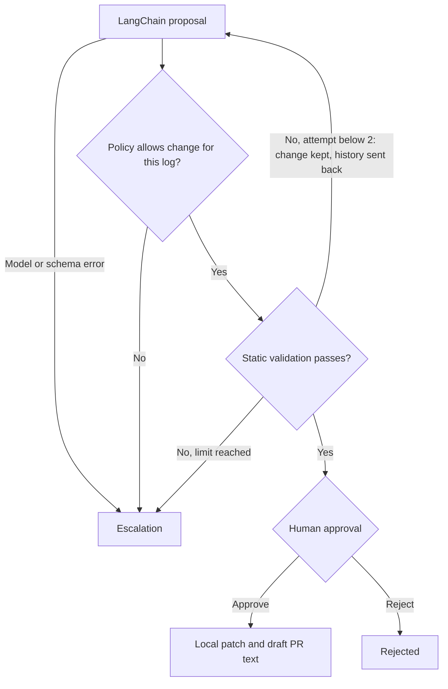

# LangGraph CI Repair Agent — PoC

A bounded CI repair workflow: diagnose a failure, propose one file change, enforce deterministic policy, validate the candidate, and request human approval before exporting a patch and draft PR text.

**Status:** local proof of concept. Uses real LangGraph orchestration and LangChain interfaces. Demo responses are scripted; Azure mode calls a real model. Neither mode creates a GitHub PR or runs remote CI.

## Scope

| Scenario | Failure | Permitted correction |
|---|---|---|
| S01 | Missing requirements file | `requirement.txt` → `requirements.txt` |
| S02 | Missing Python dependency | Append `requests` to `requirements.txt` |
| S03 | Misspelled test module | `pytests` → `pytest` |
| S04 | S01 and S02 together | Two attempts, one file each; the second sees the first |

A fix is authorized only if the failure log matches its rule, so a correct-looking change for a different failure is rejected.

Inputs are synthetic repository snapshots and failure logs. The original snapshot is never changed. Validation checks workflow commands, file references, Python syntax and the controlled dependency case. It does not prove that arbitrary application tests pass.

## Architecture



LangGraph handles conditional routing, a maximum of two proposal attempts (an accepted but insufficient change is kept in `working` and the next attempt builds on it, with the earlier attempts and reasons in `history`), SQLite checkpoint persistence and `interrupt`/`Command` approval. LangChain provides message interfaces, a demo Runnable and `AzureChatOpenAI.with_structured_output` with a Pydantic schema. A policy rejection escalates immediately.

## Quick start

Python 3.11 or newer. Run commands from the project directory:

```bash
python -m venv .venv
# Linux/macOS:
source .venv/bin/activate
# PowerShell instead:
# .venv\Scripts\Activate.ps1
python -m pip install -e '.[dev]'
python -m ci_repair.cli run --scenario S01 --thread s01-demo
python -m ci_repair.cli status --thread s01-demo
```

Read `artifacts/s01-demo/evidence.json`, including the proposed diff and validation result. Then explicitly approve or reject:

```bash
python -m ci_repair.cli approve --thread s01-demo
# OR:
python -m ci_repair.cli reject --thread s01-demo
```

Approval exports `repair.patch` and `draft-pr.md` in that thread's directory. Use a different thread ID for every new run. The SQLite checkpoint permits approval from a new process. Keep the same `--output` directory when resuming.

Run the other scenarios:

```bash
python -m ci_repair.cli run --scenario S02 --thread s02-demo
python -m ci_repair.cli run --scenario S03 --thread s03-demo
python -m ci_repair.cli run --scenario S04 --thread s04-demo   # needs two attempts
python -m pytest -q
```

## Azure OpenAI mode

Set these environment variables in your shell (a `.env` file is not loaded automatically):

- `AZURE_OPENAI_ENDPOINT`
- `AZURE_OPENAI_API_KEY`
- `AZURE_OPENAI_DEPLOYMENT`
- `OPENAI_API_VERSION` (default `2024-10-21`; use a version supported by your deployment)

The deployment must support structured output and the configured model parameters. Then run:

```bash
python -m ci_repair.cli run --mode azure --scenario S01 --thread s01-azure
```

Azure credentials and a deployment are required. Live Azure inference has not been validated in this delivery; tests only mock the Azure client to check wiring and error handling. There is no evaluation set yet, so model diagnosis quality is unmeasured. Offline demo success is not evidence of LLM diagnosis quality. Provider/schema failures escalate without exporting raw provider exception messages.

## Policy and execution boundary

Only changes that the rules in `graph.py` would themselves produce for the given log are authorized (any non-empty combination of matching rules, limited to one file per proposal). Dependencies come from an allow-list (`requests`). Arbitrary file paths, test edits, workflow permission changes and dependency URLs are rejected. The validator accepts `uses:` steps, `pip install -r/-e` and `python -m pytest ...`; any other `run` command fails validation. It only checks that `requests` is declared when imported (`import`, `from ... import`, submodules), not arbitrary dependencies. Logs are untrusted data; deterministic controls enforce the boundary even if model output follows injected instructions. The PoC does not execute generated commands or install proposed dependencies. Checkpoints and evidence contain input snapshots; use only the included synthetic inputs in this version.

## Files

| Path | Purpose |
|---|---|
| `ci_repair/graph.py` | LangGraph workflow, repair rules, model adapters, schema, policy and validator |
| `ci_repair/scenarios.py` | Four synthetic failure fixtures |
| `ci_repair/cli.py` | Run, inspect, approve or reject a persistent thread |
| `tests/test_graph.py` | Repairs, approval/rejection, restart persistence, retry with history, policy and validator edge cases, mocked Azure wiring |
| `.github/workflows/ci.yml` | Repository test workflow |
| `requirements-tested.txt` | Versions used for this delivery's checks |
| `evidence/demo-results.json` | Generated by `scripts/generate_evidence.py`; CI fails if it is stale |
| `scripts/generate_evidence.py` | Re-runs the offline scenarios and writes (or `--check`s) the evidence file |

## Next milestone

Add a read-only GitHub workflow-log adapter, validate candidate changes in an isolated runner, and publish a draft PR only after approval. Keep repository identity and commit SHA in state, re-check them before publishing, and make publication idempotent. These integrations are not part of this version.

## References

- https://docs.langchain.com/oss/python/langgraph/interrupts
- https://docs.langchain.com/oss/python/langgraph/persistence
- https://docs.langchain.com/oss/python/integrations/chat/azure_chat_openai
